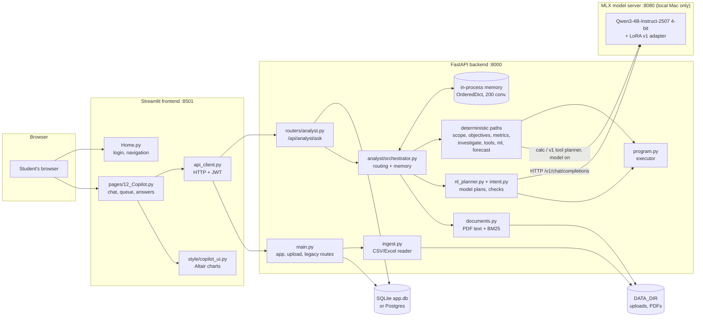
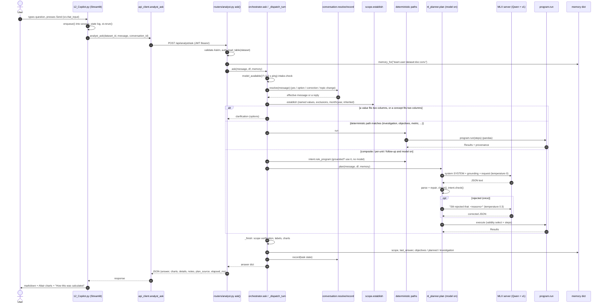
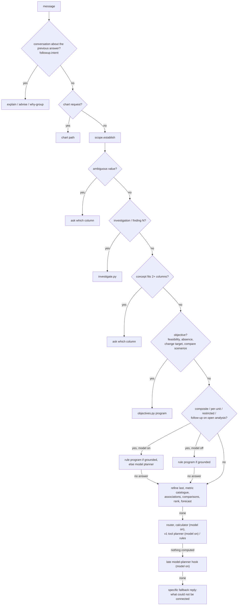
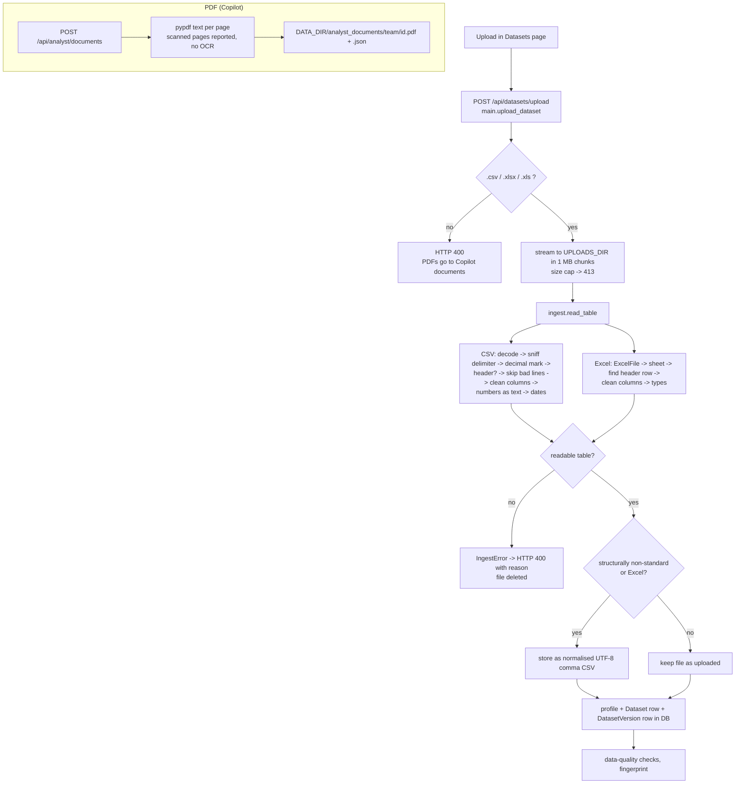
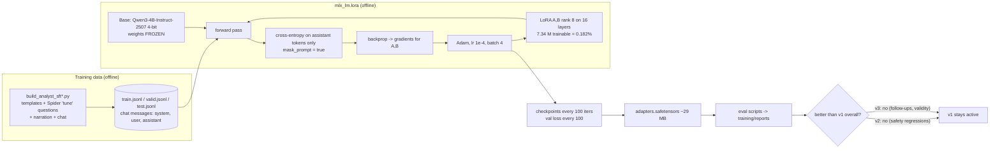
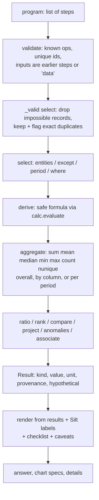
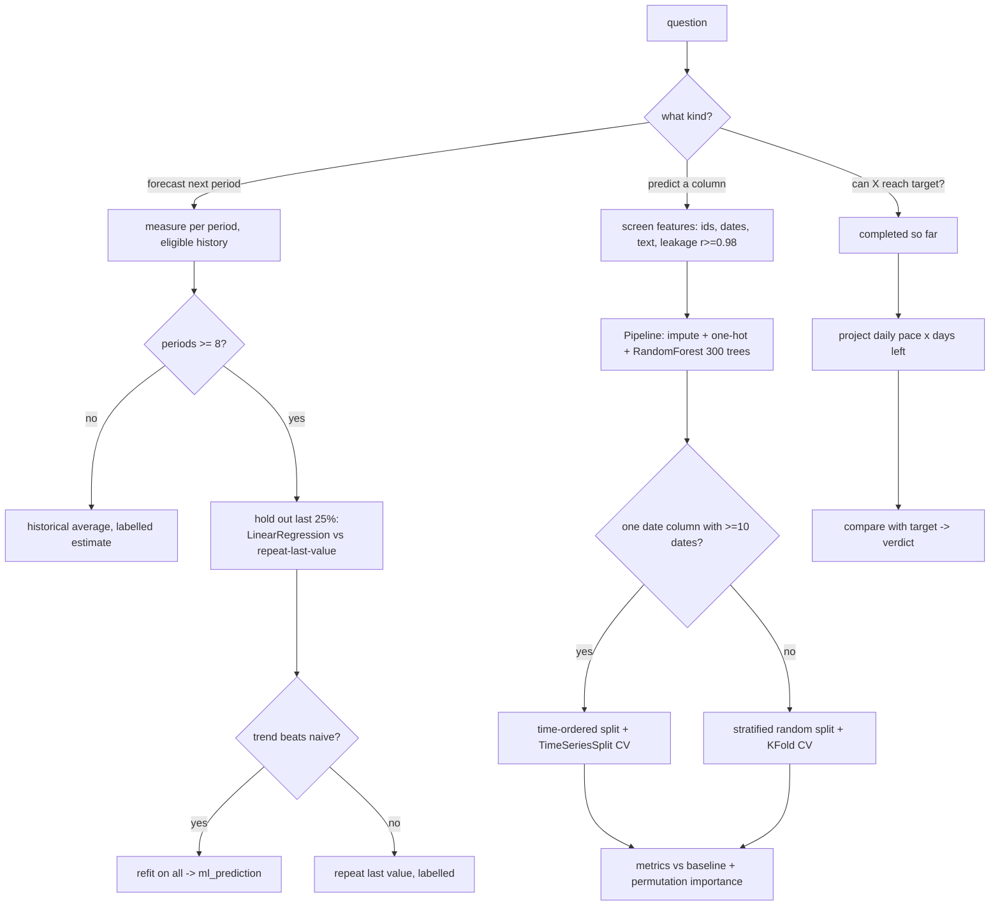
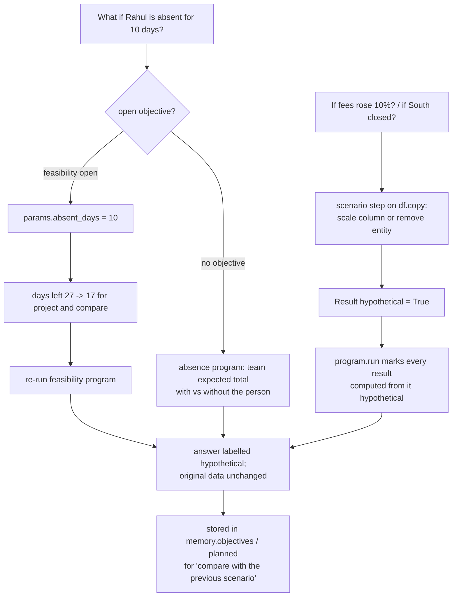

# Silt — Architecture and Execution Diagrams

All diagrams use Mermaid. Each one corresponds to code that was read during the audit. The source references are under each diagram; the explanations are in `SILT_COMPLETE_UNDER_THE_HOOD.md`.
Labels: **(offline)** means it happened in the past and does not run when the app runs; **(model on)** means it runs only when the local model server answers; **[GAP]** marks something not implemented.

---

## 1. Complete architecture

Sources: `frontend/pages/12_Copilot.py`, `frontend/api_client.py` l. 770, `backend/app/routers/analyst.py` l. 88–104, `backend/app/analyst/orchestrator.py` l. 19–20, 49, 125, `training/scripts/serve_analyst_model.sh`. On Render (hosted), the "Model" box does not exist (`Dockerfile`, `start.sh`).

---

## 2. Send button → response (sequence)

Sources: `12_Copilot.py` l. 67–77, 297–327; `api_client.py` l. 770–773; `routers/analyst.py` l. 88–104; `orchestrator.py` l. 49–99, 125–398, 517–583, 817–908; `conversation.py` l. 108, 197; `scope.py` l. 99; `nl_planner.py` l. 841–889, 971.

---

## 3. Dispatch order inside `_dispatch_turn` (simplified)

Source: `orchestrator.py` l. 112–398. The 12-second model budget (`MODEL_TURN_BUDGET_MS`, l. 400) switches the later model paths to their rules after a slow planner attempt.

---

## 4. Data upload flow

Sources: `main.py` l. 166–281; `ingest.py` l. 36–282; `documents.py` l. 42–118.

---

## 5. Model training pipeline (offline, historical)

Sources: `training/adapters/*/adapter_config.json`, `train.log`, `training/data/*/MANIFEST.json`, `training/reports/*.md`, `adapters/analyst_qwen3_4b_lora_v3/EVAL_COMPARISON.md`. v3 stopped at iteration 430 of 800; its final file equals the 400 checkpoint.

---

## 6. Model inference pipeline (model on)

```mermaid
flowchart LR
  Q[question] --> G[grounding: columns + roles + safe summaries<br/>+ derivable measures + named values<br/>+ date tokens + conversation state]
  G --> PR[messages: SYSTEM + grounding + request]
  PR -->|OpenAI client, HTTP| S[mlx_lm server]
  S --> TK[chat template + tokenizer<br/>text -> token IDs]
  TK --> TF[transformer forward pass<br/>base weights + B·A adapter]
  TF --> LG[logits over 151,936 tokens]
  LG --> DEC[greedy pick, temperature 0<br/>repeat up to 700 tokens]
  DEC --> TXT[JSON text]
  TXT --> PA[parse + one-meaning repairs]
  PA --> CH[check: ops, columns, values, types,<br/>units, stated numbers, dependencies]
  CH --> IN[intent.check: quantity, measure, grouping,<br/>denominator, entities, restriction]
  IN -- ok --> EX[program.run]
  CH & IN -- rejected --> RP{budget left?}
  RP -- yes --> S
  RP -- no --> FB[deterministic fallback]
```

Sources: `nl_planner.py` l. 175–258 (grounding), 306 (parse), 356 (check), 819 (`_chat`), 841 (plan); `intent.py` l. 279.

---

## 7. Calculation pipeline (`program.run`)

Sources: `program.py` l. 103–461; `nl_planner.execute` l. 971, `render` l. 1090.

---

## 8. Prediction pipeline

Sources: `followup.py` l. 460, 501–630; `ml.py` l. 42–324; `objectives.py` l. 177–252; `program.py` l. 212–296. [GAP] No seasonality and no forecast intervals.

---

## 9. Scenario simulation

Sources: `objectives.py` l. 235–239 (absence days), 307 (`_absence`), 460 (`handle`), 593 (`_compare_scenarios`); `program.py` l. 298 (`op_scenario`), 450–461 (propagation). [GAP] "working days" are subtracted as calendar days.
